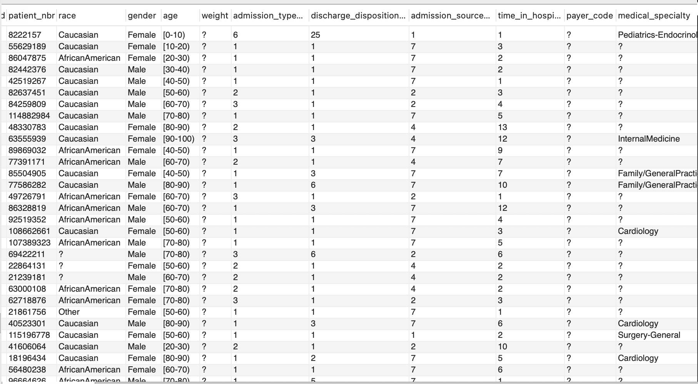
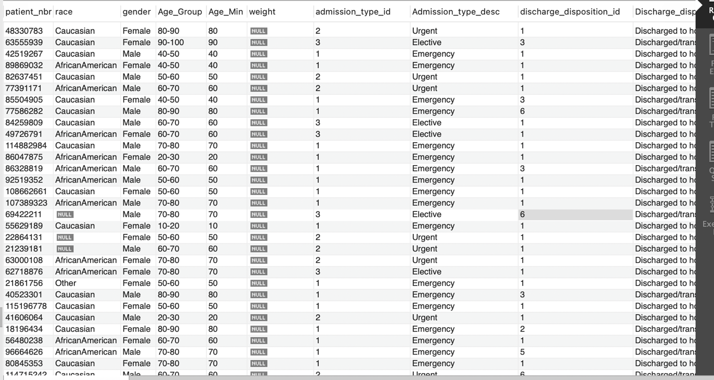
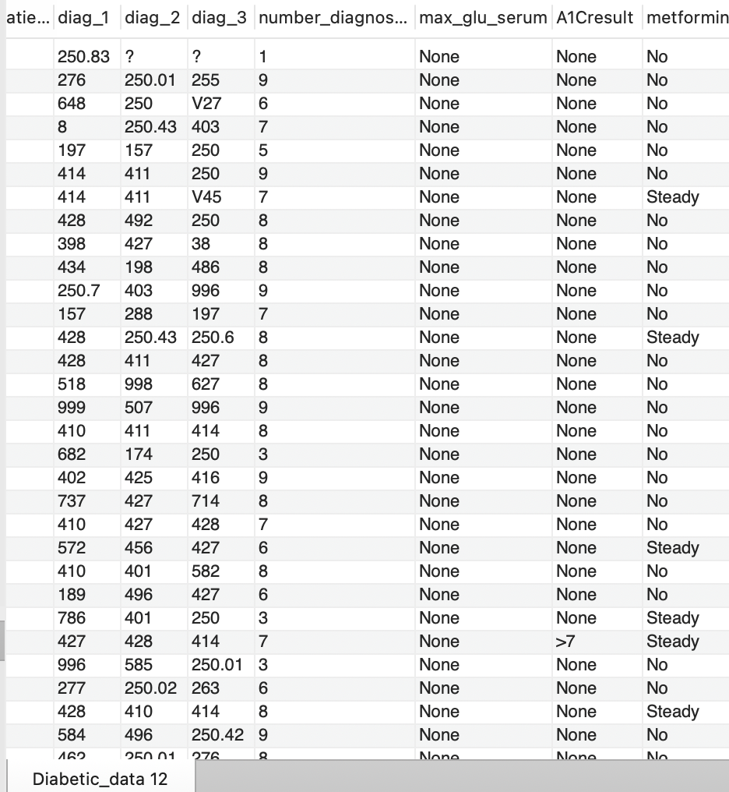
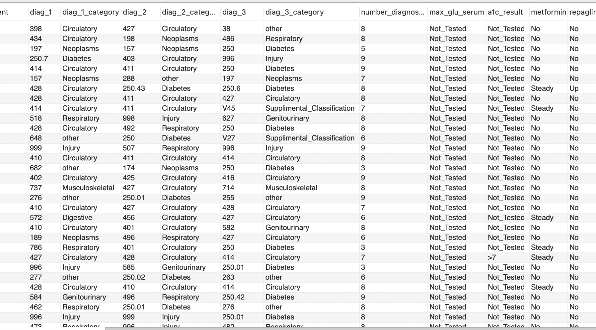

# Diabetic Patients Data Cleaning with MySQL

Cleaning a messy 100,100-row, 50-column diabetic patients dataset into an analysis-ready table using MySQL.

## Goal

Profile the raw data, document every quality issue, clean it using MySQL, and build a documented, validated, analysis-ready table.

## Tools

MySQL Workbench

## Dataset

| File | Description |
|------|-------------|
| `diabetic_data.csv` | 100,100 rows x 50 columns. One row per hospital encounter: demographics, admission and discharge details, lab results, 23 diabetes medication columns, diagnoses (ICD-9) and a readmission outcome |
| `IDS_mapping.csv` | Lookup descriptions for `admission_type_id`, `discharge_disposition_id` and `admission_source_id` |

**Source:** UCI Machine Learning Repository, *Diabetes 130-US hospitals for years 1999-2008*. Original study: Strack et al. (2014), *Impact of HbA1c Measurement on Hospital Readmission Rates*, BioMed Research International.

## Project structure

| File | Purpose |
|------|---------|
| `01_setup_and_import.sql` | Create database, raw table, staging copy |
| `02_audit.sql` | Profile the data and record problems |
| `03_cleaning.sql` | Apply the fixes |
| `04_validation.sql` | Verify counts, NULLs and ranges |

**NB:** Run the scripts in order. Import the CSV with the Table Data Import Wizard between Part A and Part B of script 01.

## Issues found and fixes

| Column | Issue | Fix |
|--------|-------|-----|
| `weight`, `payer_code`, `medical_specialty`, `race`, `diag_1`, `diag_2`, `diag_3` | Missing values coded as "?" | Converted to NULL |
| `max_glu_serum`, `A1Cresult` | "None" values meaning the test was not done | Converted to "Not tested" so they are not mistaken for missing data |
| `age` | Stored as ranges in brackets, such as [20-30) | Removed the brackets and added an `age_min` column |
| `change`, `glyburide-metformin`, `glipizide-metformin`, `glimepiride-pioglitazone`, `metformin-rosiglitazone`, `metformin-pioglitazone` | Column names unusable in MySQL (hyphens and a reserved word) | Renamed the columns |
| `patient_nbr` | Repeat patients | Created a `diabetic_first_encounter` table with one row per patient |
| `gender` | Invalid gender values | Converted to NULL |
| `IDS_mapping` | Three ID categories stacked in one file | Created a separate table for each ID category |

## Checked and found clean

- Duplicate encounter IDs

## Before and after

### "?" values and ID descriptions

**Before (raw)**

**After (cleaned)**

### Diagnosis, max_glu_serum and A1Cresult

**Before (raw)**

**After (cleaned)**

## Judgement calls

1. **Raw data is never modified.** All cleaning happens on a copy.
2. **NULL vs "Not tested".** NULL means the value is unknown. "Not tested" means a test was not performed.
3. **First encounter is based on `encounter_id`.** The dataset has no admission dates, so ordering by encounter ID assumes IDs were assigned in time order.
4. **Diagnosis grouping follows Strack et al. (2014).**
5. **Several IDs have the same meaning** (Not available, NULL, Not mapped), so they were combined into "Unknown".
